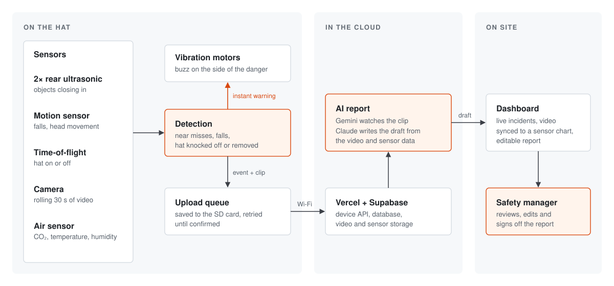

# Argus

Argus turns a standard hard hat into a dash cam for construction workers.

Near misses happen on job sites every day, and almost none get reported. Writing one up is slow and awkward, so sites end up learning from injuries instead of the close calls that came before them. Argus catches those moments automatically and turns them into a report a safety manager can act on at the next toolbox talk.

We built it in a weekend at natHacks 2026 in Edmonton.

## How it works

A small kit clips onto the hat: a Raspberry Pi, a camera, two ultrasonic sensors facing backward, a motion sensor, and a vibration motor on each side.

When something closes in from behind, the hat buzzes on that side. When the wearer falls, it saves the 20 seconds of video before the fall and the 10 seconds after. Each event goes to the cloud with its sensor data, and the upload keeps retrying until it lands, so a dead spot on site doesn't lose anything.

From there, Gemini watches the clip and Claude writes an incident report in Canadian OHS style: what happened, the likely causes, a risk rating and corrective actions. If a near miss came just before a fall, the report connects the two.

The report shows up on a live dashboard next to the video and a sensor chart. It's always a draft. A manager reads it, edits it and signs it off, and every change is kept.



## What it detects

| Event | Trigger | Logged as |
|---|---|---|
| Struck-by near miss | An object closing on a rear sensor over several readings, with head turns and the wearer's own motion filtered out | Near miss |
| Fall | Free fall or a hard hit, then the head re-oriented and still, while the hat is worn | Incident |
| Hat knocked off | The hat leaves the head right after a fall | Incident |
| Hat removed | The hat comes off with no fall | PPE log |

## Hardware

Raspberry Pi 4, Pi Camera, Pololu MinIMU-9 v3 (accelerometer and gyro), 2× HC-SR04 ultrasonic sensors, VL6180X time-of-flight sensor (hat on or off), 2× DRV2605L haptic drivers with vibration motors, and an SCD41 for CO₂, temperature and humidity.

The full pinout is in [Argus_Hat_Wiring.md](device/pi_bringup/Argus_Hat_Wiring.md).

## Software

The hat runs Python. The dashboard and device API are Next.js on Vercel, and Supabase handles the database, file storage, login and live updates.

```
device/pi_bringup/     code that runs the hat
device/argus/bridge/   connects the hat to the cloud
web/                   dashboard and API
worker/                AI report pipeline
supabase/              database and security rules
contracts/             data formats shared across the system
```

## Running it

To try the whole system on a laptop with a simulated hat, you'll need macOS, [Homebrew](https://brew.sh) and Docker Desktop:

```bash
brew install uv node@22 pnpm ffmpeg
git clone https://github.com/Akileash/Argus.git && cd Argus
pnpm install && (cd device && uv sync)
./scripts/demo-e2e.sh --reset --keep-running
```

When it prints `RESULT: PASS`, open http://127.0.0.1:3400 and log in with `demo@argus.local` / `argus-demo-2026`. AI keys are optional; copy [.env.example](.env.example) to `.env` to use them.

To run it on a real hat, see [PI-BRINGUP.md](docs/PI-BRINGUP.md). For hosting, see [HOSTED.md](docs/HOSTED.md).

## Limits

This is a prototype. Detection is tuned on a small number of test falls, so it will miss some events and flag others that weren't real. The hat has no contact sensor, so a near miss is reported as the likely cause of a fall, never a confirmed strike. And it detects falls; it doesn't prevent them. Every report is a draft for a competent person to review, not a compliance filing.

## Team

Akileash Saravanan, Dhir Patel, Dip Khadka, Hari Mallampalli, Okitha Biyanwila and Shreay Patel.
